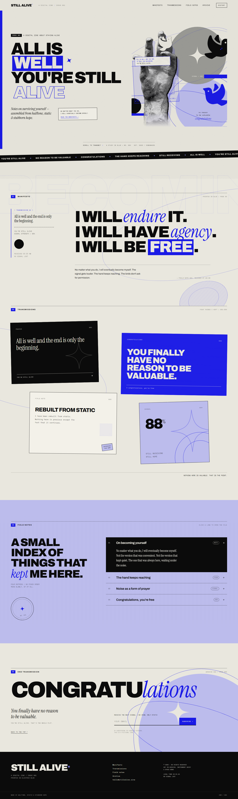

# STILL ALIVE®

A small digital zine about surviving yourself, assembled from halftone, static and stubborn hope.

**[Read it →](https://hayaaitfx-ops.github.io/still-alive/)** · **[Companion poster →](https://hayaaitfx-ops.github.io/still-alive/poster-site/)**



## Run locally

Plain HTML, CSS and JS, no build step:

```powershell
python -m http.server 8000
```

Open `http://localhost:8000/` (zine) or `http://localhost:8000/poster-site/` (poster).

> The newsletter form is a front-end demo only. It doesn't store anything.