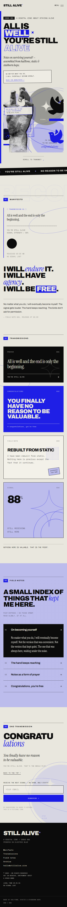

# STILL ALIVE®

> **All is well. You're still alive.**

A small digital zine about surviving yourself, assembled from halftone, static and stubborn hope.

**[Read Issue 001 →](https://hayaaitfx-ops.github.io/still-alive/)** · **[Companion poster →](https://hayaaitfx-ops.github.io/still-alive/poster-site/)**


## What is this

Still Alive is a fictional, single-issue digital zine: four sections (Manifesto, Transmissions, Field notes, Archive) of short, hopeful texts about enduring and becoming yourself. The design mixes punk-zine print with signal and static, with halftone textures, electric blue on off-white paper, and a hand that keeps reaching.

The repository holds two static sites:

| Site | Folder | Description |
| --- | --- | --- |
| **Still Alive** | [`still-alive/`](still-alive/) | The main zine |
| **Poster** | [`poster-site/`](poster-site/) | A companion poster experience |

The root [`index.html`](index.html) redirects to the zine.

## Features

- Scroll progress bar and reveal-on-scroll animations
- Hero parallax and custom cursor (fine pointers only)
- Accordion "field notes" and a "distort" glitch button
- Live local clock in the footer
- Responsive layout with a dedicated mobile menu
- Accessibility: respects `prefers-reduced-motion`, uses `aria-expanded` and `inert`, restores focus when menus close



## Tech

Plain HTML, CSS and vanilla JavaScript. No framework, no build step, no dependencies.

Typefaces: Archivo, Instrument Serif and Space Mono (loaded from Google Fonts, with system fallbacks if offline).

## Run locally

From the repository root:

```powershell
python -m http.server 8000
```

Then open:

- `http://localhost:8000/` for the zine
- `http://localhost:8000/poster-site/` for the poster

## Project structure

```text
.
├── index.html            # redirects to still-alive/
├── still-alive/
│   ├── index.html
│   ├── assets/           # styles.css, main.js, images
│   ├── shots/            # design iteration screenshots
│   └── tools/            # shot.mjs (screenshots), gh-login.mjs
└── poster-site/
    ├── index.html
    ├── css/ js/ assets/
    ├── shots/
    └── tools/            # cut.ps1 (image cutout helper)
```

## Notes

- The newsletter form is a front-end demonstration only. It does not submit or store email addresses.
- `.scratch/` (browser profile) and local `AGENTS.md` notes are intentionally kept out of the public repository.